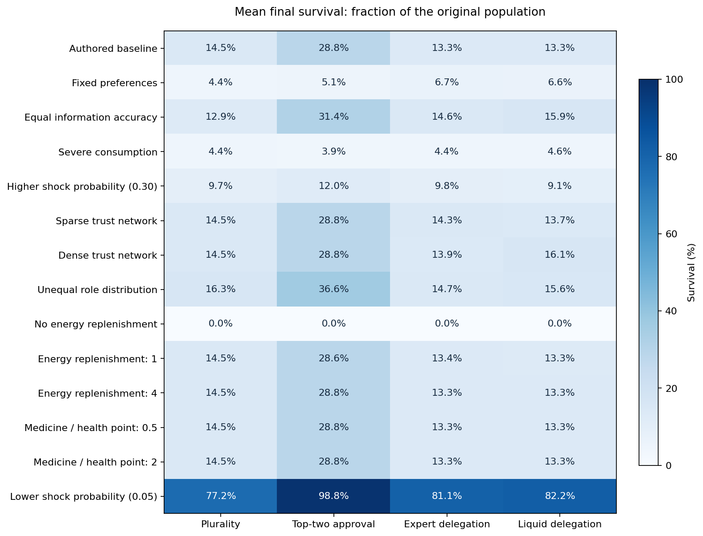
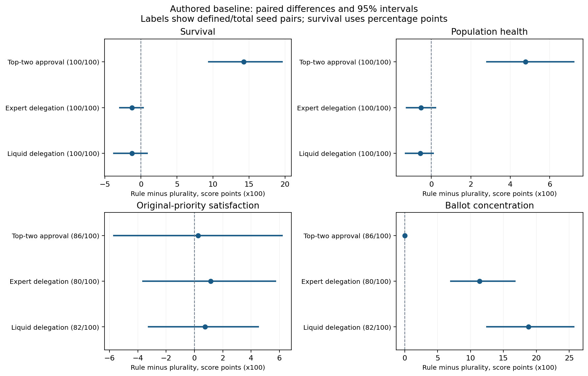

# Governance Experiment: Results and Interpretation

5,600 trajectories; 100 seeds per rule/condition; 40 cycles; 14 conditions. Physics: `stock-budgeted-v2`.

## What to Read First

1308/5600 trajectories end with no survivors. This aggregate combines different conditions; use the per-condition rows below for comparisons. A non-extinct colony may still have lost most residents.

Survival and population health are the primary material outcomes. Satisfaction and ballot concentration describe representation, conditional on a surviving electorate. There is no overall institution ranking or composite political-quality score.

This is exploratory analysis of authored assumptions, not a preregistered confirmatory study or empirical prediction. Tests establish implementation behavior; simulation consistency checks do not establish empirical validity.

Validation status: **PASS**. Warnings: none.

## Outcome Dashboard

Survival is a percentage of the original population. Population health is the mean health of that population, assigning zero to deaths, scaled to 0-100. Extinction is the number of trials ending at zero survivors. Active cycles exclude post-extinction placeholders. Both healthy and severely depleted colonies can be non-extinct.

| Condition | Rule | Survival % | Extinct / runs | Population health /100 | Blocked / active cycles |
| --- | --- | ---: | ---: | ---: | ---: |
| Authored baseline | Plurality | 14.5 | 13/100 | 5.3 | 0/3833 |
| Authored baseline | Top-two approval | 28.8 | 5/100 | 10.1 | 0/3973 |
| Authored baseline | Expert delegation | 13.3 | 14/100 | 4.8 | 0/3841 |
| Authored baseline | Liquid delegation | 13.3 | 10/100 | 4.8 | 0/3878 |
| Fixed preferences | Plurality | 4.4 | 87/100 | 2.3 | 0/2623 |
| Fixed preferences | Top-two approval | 5.1 | 80/100 | 2.8 | 0/2766 |
| Fixed preferences | Expert delegation | 6.7 | 80/100 | 4.1 | 0/2886 |
| Fixed preferences | Liquid delegation | 6.6 | 77/100 | 4.0 | 0/2883 |
| Equal information accuracy | Plurality | 12.9 | 13/100 | 4.9 | 0/3826 |
| Equal information accuracy | Top-two approval | 31.4 | 6/100 | 10.5 | 0/3949 |
| Equal information accuracy | Expert delegation | 14.6 | 19/100 | 5.2 | 0/3818 |
| Equal information accuracy | Liquid delegation | 15.9 | 17/100 | 5.2 | 0/3809 |
| Severe consumption | Plurality | 4.4 | 20/100 | 1.9 | 0/3640 |
| Severe consumption | Top-two approval | 3.9 | 35/100 | 2.1 | 0/3149 |
| Severe consumption | Expert delegation | 4.4 | 22/100 | 1.9 | 0/3598 |
| Severe consumption | Liquid delegation | 4.6 | 19/100 | 2.0 | 0/3669 |
| Higher shock probability (0.30) | Plurality | 9.7 | 25/100 | 3.4 | 0/3670 |
| Higher shock probability (0.30) | Top-two approval | 12.0 | 17/100 | 4.0 | 0/3803 |
| Higher shock probability (0.30) | Expert delegation | 9.8 | 24/100 | 3.4 | 0/3682 |
| Higher shock probability (0.30) | Liquid delegation | 9.1 | 25/100 | 3.3 | 0/3670 |
| Sparse trust network | Plurality | 14.5 | 13/100 | 5.3 | 0/3833 |
| Sparse trust network | Top-two approval | 28.8 | 5/100 | 10.1 | 0/3973 |
| Sparse trust network | Expert delegation | 14.3 | 15/100 | 4.9 | 0/3848 |
| Sparse trust network | Liquid delegation | 13.7 | 17/100 | 5.1 | 0/3809 |
| Dense trust network | Plurality | 14.5 | 13/100 | 5.3 | 0/3833 |
| Dense trust network | Top-two approval | 28.8 | 5/100 | 10.1 | 0/3973 |
| Dense trust network | Expert delegation | 13.9 | 12/100 | 4.7 | 0/3862 |
| Dense trust network | Liquid delegation | 16.1 | 9/100 | 5.6 | 0/3891 |
| Unequal role distribution | Plurality | 16.3 | 9/100 | 6.0 | 0/3904 |
| Unequal role distribution | Top-two approval | 36.6 | 5/100 | 12.3 | 0/3952 |
| Unequal role distribution | Expert delegation | 14.7 | 13/100 | 5.1 | 0/3836 |
| Unequal role distribution | Liquid delegation | 15.6 | 14/100 | 5.9 | 0/3829 |
| No energy replenishment | Plurality | 0.0 | 100/100 | 0.0 | 348/2829 |
| No energy replenishment | Top-two approval | 0.0 | 100/100 | 0.0 | 494/2979 |
| No energy replenishment | Expert delegation | 0.0 | 100/100 | 0.0 | 373/2864 |
| No energy replenishment | Liquid delegation | 0.0 | 100/100 | 0.0 | 348/2834 |
| Energy replenishment: 1 | Plurality | 14.5 | 13/100 | 5.3 | 0/3833 |
| Energy replenishment: 1 | Top-two approval | 28.6 | 6/100 | 9.9 | 0/3965 |
| Energy replenishment: 1 | Expert delegation | 13.4 | 14/100 | 4.8 | 0/3841 |
| Energy replenishment: 1 | Liquid delegation | 13.3 | 11/100 | 4.8 | 0/3878 |
| Energy replenishment: 4 | Plurality | 14.5 | 13/100 | 5.3 | 0/3833 |
| Energy replenishment: 4 | Top-two approval | 28.8 | 5/100 | 10.1 | 0/3973 |
| Energy replenishment: 4 | Expert delegation | 13.3 | 14/100 | 4.8 | 0/3841 |
| Energy replenishment: 4 | Liquid delegation | 13.3 | 10/100 | 4.8 | 0/3878 |
| Medicine / health point: 0.5 | Plurality | 14.5 | 13/100 | 5.3 | 0/3833 |
| Medicine / health point: 0.5 | Top-two approval | 28.8 | 5/100 | 10.1 | 0/3973 |
| Medicine / health point: 0.5 | Expert delegation | 13.3 | 14/100 | 4.8 | 0/3841 |
| Medicine / health point: 0.5 | Liquid delegation | 13.3 | 10/100 | 4.8 | 0/3878 |
| Medicine / health point: 2 | Plurality | 14.5 | 13/100 | 5.3 | 0/3833 |
| Medicine / health point: 2 | Top-two approval | 28.8 | 5/100 | 10.1 | 0/3973 |
| Medicine / health point: 2 | Expert delegation | 13.3 | 14/100 | 4.8 | 0/3841 |
| Medicine / health point: 2 | Liquid delegation | 13.3 | 10/100 | 4.8 | 0/3878 |
| Lower shock probability (0.05) | Plurality | 77.2 | 0/100 | 44.2 | 0/4000 |
| Lower shock probability (0.05) | Top-two approval | 98.8 | 0/100 | 72.1 | 0/4000 |
| Lower shock probability (0.05) | Expert delegation | 81.1 | 0/100 | 49.0 | 0/4000 |
| Lower shock probability (0.05) | Liquid delegation | 82.2 | 0/100 | 49.8 | 0/4000 |

## Paired Effects Against Plurality

Each cell is mean difference [95% percentile bootstrap interval]; defined/total seed pairs. Every difference is rule minus plurality, multiplied by 100. For survival these are percentage points, not relative percent changes; other metrics use score points. Positive survival, health, or satisfaction differences raise that measure; negative concentration differences disperse ballot control. No interval is shown with fewer than two defined pairs.

| Condition | Rule vs plurality | Survival | Population health | Original satisfaction | Concentration |
| --- | --- | --- | --- | --- | --- |
| Authored baseline | Top-two approval | 14.3 [9.3, 19.7]; 100/100 | 4.8 [2.8, 7.2]; 100/100 | 0.3 [-5.8, 6.2]; 86/100 | -0.0 [-0.0, 0.0]; 86/100 |
| Authored baseline | Expert delegation | -1.2 [-3.0, 0.4]; 100/100 | -0.5 [-1.3, 0.2]; 100/100 | 1.1 [-3.7, 5.8]; 80/100 | 11.4 [6.9, 16.9]; 80/100 |
| Authored baseline | Liquid delegation | -1.2 [-3.9, 1.0]; 100/100 | -0.6 [-1.4, 0.1]; 100/100 | 0.8 [-3.3, 4.6]; 82/100 | 18.8 [12.4, 25.8]; 82/100 |
| Fixed preferences | Top-two approval | 0.7 [-3.0, 4.5]; 100/100 | 0.4 [-2.0, 2.8]; 100/100 | 1.6 [-21.4, 20.0]; 6/100 | 0.0 [0.0, 0.0]; 6/100 |
| Fixed preferences | Expert delegation | 2.3 [-0.4, 5.3]; 100/100 | 1.8 [0.2, 3.5]; 100/100 | -4.4 [-15.3, 4.0]; 11/100 | 4.3 [3.1, 5.5]; 11/100 |
| Fixed preferences | Liquid delegation | 2.2 [-1.3, 6.1]; 100/100 | 1.6 [-0.6, 4.0]; 100/100 | 7.3 [-0.0, 19.4]; 9/100 | 8.1 [2.8, 15.8]; 9/100 |
| Equal information accuracy | Top-two approval | 18.6 [12.9, 24.7]; 100/100 | 5.7 [3.5, 8.2]; 100/100 | -5.3 [-11.9, 1.4]; 82/100 | 0.0 [-0.0, 0.0]; 82/100 |
| Equal information accuracy | Expert delegation | 1.8 [-0.3, 4.0]; 100/100 | 0.3 [-0.8, 1.3]; 100/100 | -4.5 [-10.1, 0.9]; 72/100 | 11.5 [7.0, 16.6]; 72/100 |
| Equal information accuracy | Liquid delegation | 3.1 [0.2, 6.4]; 100/100 | 0.3 [-0.8, 1.4]; 100/100 | -4.1 [-9.9, 2.5]; 75/100 | 12.9 [8.7, 17.9]; 75/100 |
| Severe consumption | Top-two approval | -0.6 [-1.4, 0.2]; 100/100 | 0.2 [-0.2, 0.6]; 100/100 | 10.6 [2.0, 19.4]; 54/100 | 0.0 [-0.0, 0.0]; 54/100 |
| Severe consumption | Expert delegation | 0.0 [-0.4, 0.4]; 100/100 | -0.0 [-0.2, 0.1]; 100/100 | -0.4 [-1.9, 1.2]; 77/100 | 10.7 [5.2, 16.7]; 77/100 |
| Severe consumption | Liquid delegation | 0.1 [-0.1, 0.4]; 100/100 | 0.1 [-0.1, 0.2]; 100/100 | 0.3 [-1.3, 2.1]; 78/100 | 12.1 [6.3, 18.5]; 78/100 |
| Higher shock probability (0.30) | Top-two approval | 2.3 [-0.3, 5.2]; 100/100 | 0.6 [-0.5, 1.9]; 100/100 | -9.2 [-16.0, -2.2]; 64/100 | -0.0 [-0.0, 0.0]; 64/100 |
| Higher shock probability (0.30) | Expert delegation | 0.0 [-1.6, 1.5]; 100/100 | 0.1 [-0.5, 0.7]; 100/100 | -0.8 [-5.7, 3.8]; 72/100 | 13.5 [8.2, 19.2]; 72/100 |
| Higher shock probability (0.30) | Liquid delegation | -0.6 [-1.9, 0.6]; 100/100 | -0.1 [-0.7, 0.3]; 100/100 | -1.1 [-5.8, 3.9]; 68/100 | 10.2 [5.9, 15.2]; 68/100 |
| Sparse trust network | Top-two approval | 14.3 [9.2, 19.6]; 100/100 | 4.8 [2.7, 7.2]; 100/100 | 0.3 [-6.1, 6.4]; 86/100 | -0.0 [-0.0, 0.0]; 86/100 |
| Sparse trust network | Expert delegation | -0.3 [-2.9, 2.1]; 100/100 | -0.4 [-1.2, 0.3]; 100/100 | 2.9 [-1.5, 7.3]; 81/100 | 2.6 [0.9, 5.4]; 81/100 |
| Sparse trust network | Liquid delegation | -0.9 [-2.4, 0.6]; 100/100 | -0.3 [-0.9, 0.5]; 100/100 | 0.0 [-5.1, 5.4]; 80/100 | 2.4 [0.7, 5.3]; 80/100 |
| Dense trust network | Top-two approval | 14.3 [9.2, 19.7]; 100/100 | 4.8 [2.7, 7.1]; 100/100 | 0.3 [-5.7, 6.3]; 86/100 | -0.0 [-0.0, 0.0]; 86/100 |
| Dense trust network | Expert delegation | -0.7 [-3.2, 1.9]; 100/100 | -0.7 [-1.9, 0.3]; 100/100 | -0.1 [-5.5, 5.1]; 82/100 | 28.0 [21.3, 34.7]; 82/100 |
| Dense trust network | Liquid delegation | 1.6 [-1.7, 4.9]; 100/100 | 0.2 [-0.9, 1.6]; 100/100 | 2.1 [-3.4, 7.6]; 84/100 | 26.2 [18.9, 34.1]; 84/100 |
| Unequal role distribution | Top-two approval | 20.3 [14.7, 26.5]; 100/100 | 6.4 [3.7, 9.6]; 100/100 | -2.2 [-8.0, 3.4]; 87/100 | 0.0 [-0.0, 0.0]; 87/100 |
| Unequal role distribution | Expert delegation | -1.6 [-5.1, 1.3]; 100/100 | -0.9 [-2.3, 0.2]; 100/100 | -0.1 [-4.3, 4.0]; 82/100 | 10.4 [7.6, 13.5]; 82/100 |
| Unequal role distribution | Liquid delegation | -0.8 [-4.0, 2.5]; 100/100 | -0.0 [-1.4, 1.0]; 100/100 | -2.1 [-6.9, 2.6]; 83/100 | 12.5 [8.7, 17.2]; 83/100 |
| No energy replenishment | Top-two approval | 0.0 [0.0, 0.0]; 100/100 | 0.0 [0.0, 0.0]; 100/100 | N/A [N/A, N/A]; 0/100 | N/A [N/A, N/A]; 0/100 |
| No energy replenishment | Expert delegation | 0.0 [0.0, 0.0]; 100/100 | 0.0 [0.0, 0.0]; 100/100 | N/A [N/A, N/A]; 0/100 | N/A [N/A, N/A]; 0/100 |
| No energy replenishment | Liquid delegation | 0.0 [0.0, 0.0]; 100/100 | 0.0 [0.0, 0.0]; 100/100 | N/A [N/A, N/A]; 0/100 | N/A [N/A, N/A]; 0/100 |
| Energy replenishment: 1 | Top-two approval | 14.1 [9.0, 19.8]; 100/100 | 4.6 [2.7, 6.8]; 100/100 | 0.2 [-5.5, 5.9]; 85/100 | -0.0 [-0.0, 0.0]; 85/100 |
| Energy replenishment: 1 | Expert delegation | -1.1 [-2.9, 0.6]; 100/100 | -0.5 [-1.3, 0.3]; 100/100 | 1.0 [-3.4, 5.7]; 80/100 | 12.0 [7.4, 17.4]; 80/100 |
| Energy replenishment: 1 | Liquid delegation | -1.2 [-3.9, 1.0]; 100/100 | -0.6 [-1.4, 0.1]; 100/100 | 1.4 [-3.0, 5.9]; 82/100 | 18.8 [12.6, 25.5]; 82/100 |
| Energy replenishment: 4 | Top-two approval | 14.3 [9.5, 20.0]; 100/100 | 4.8 [2.6, 7.2]; 100/100 | 0.3 [-5.7, 6.2]; 86/100 | -0.0 [-0.0, 0.0]; 86/100 |
| Energy replenishment: 4 | Expert delegation | -1.2 [-3.0, 0.5]; 100/100 | -0.5 [-1.3, 0.2]; 100/100 | 1.1 [-3.5, 5.6]; 80/100 | 11.4 [6.9, 16.5]; 80/100 |
| Energy replenishment: 4 | Liquid delegation | -1.2 [-3.9, 0.9]; 100/100 | -0.6 [-1.3, 0.1]; 100/100 | 0.8 [-3.2, 4.8]; 82/100 | 18.8 [12.5, 25.5]; 82/100 |
| Medicine / health point: 0.5 | Top-two approval | 14.3 [9.3, 20.0]; 100/100 | 4.8 [2.7, 7.0]; 100/100 | 0.3 [-5.5, 6.3]; 86/100 | -0.0 [-0.0, 0.0]; 86/100 |
| Medicine / health point: 0.5 | Expert delegation | -1.2 [-2.9, 0.5]; 100/100 | -0.5 [-1.3, 0.2]; 100/100 | 1.1 [-3.8, 5.8]; 80/100 | 11.4 [7.1, 16.9]; 80/100 |
| Medicine / health point: 0.5 | Liquid delegation | -1.2 [-3.8, 1.0]; 100/100 | -0.6 [-1.4, 0.1]; 100/100 | 0.8 [-3.4, 4.8]; 82/100 | 18.8 [12.4, 26.0]; 82/100 |
| Medicine / health point: 2 | Top-two approval | 14.3 [9.5, 19.8]; 100/100 | 4.8 [2.8, 7.1]; 100/100 | 0.3 [-5.5, 6.3]; 86/100 | -0.0 [-0.0, 0.0]; 86/100 |
| Medicine / health point: 2 | Expert delegation | -1.2 [-3.0, 0.4]; 100/100 | -0.5 [-1.3, 0.2]; 100/100 | 1.1 [-3.8, 5.8]; 80/100 | 11.4 [6.9, 17.1]; 80/100 |
| Medicine / health point: 2 | Liquid delegation | -1.2 [-3.9, 1.1]; 100/100 | -0.6 [-1.3, 0.1]; 100/100 | 0.8 [-3.4, 4.7]; 82/100 | 18.8 [12.5, 25.8]; 82/100 |
| Lower shock probability (0.05) | Top-two approval | 21.6 [14.7, 28.2]; 100/100 | 27.9 [22.6, 33.2]; 100/100 | -0.9 [-2.6, 0.8]; 100/100 | 0.0 [-0.0, 0.0]; 100/100 |
| Lower shock probability (0.05) | Expert delegation | 3.9 [0.8, 7.5]; 100/100 | 4.8 [1.8, 8.1]; 100/100 | 0.1 [-1.3, 1.6]; 100/100 | 7.4 [5.5, 10.1]; 100/100 |
| Lower shock probability (0.05) | Liquid delegation | 5.0 [1.3, 9.3]; 100/100 | 5.6 [1.6, 9.8]; 100/100 | 0.5 [-0.9, 2.1]; 100/100 | 12.3 [10.1, 15.2]; 100/100 |

## Representation and Coverage

Values below are conditional means /100, with the number of defined runs (n). The paired table instead uses the intersection of defined runs under both rules. Different survivor/electorate subsets can change these estimates. Even complete run coverage does not imply that most residents survived.

| Condition | Rule | Original-priority satisfaction /100 (n) | Concentration /100 (n) |
| --- | --- | ---: | ---: |
| Energy replenishment: 4 | Top-two approval | 52.9 (96) | 0.0 (96) |
| Energy replenishment: 4 | Expert delegation | 56.2 (86) | 11.6 (86) |
| Energy replenishment: 4 | Liquid delegation | 54.9 (90) | 17.3 (90) |
| Energy replenishment: 4 | Plurality | 53.0 (87) | 0.0 (87) |
| Energy replenishment: 1 | Top-two approval | 52.8 (95) | 0.0 (95) |
| Energy replenishment: 1 | Expert delegation | 56.0 (86) | 12.2 (86) |
| Energy replenishment: 1 | Liquid delegation | 55.5 (90) | 17.3 (90) |
| Energy replenishment: 1 | Plurality | 53.0 (87) | 0.0 (87) |
| No energy replenishment | Top-two approval | N/A (0) | N/A (0) |
| No energy replenishment | Expert delegation | N/A (0) | N/A (0) |
| No energy replenishment | Liquid delegation | N/A (0) | N/A (0) |
| No energy replenishment | Plurality | N/A (0) | N/A (0) |
| Higher shock probability (0.30) | Top-two approval | 46.0 (83) | 0.0 (83) |
| Higher shock probability (0.30) | Expert delegation | 53.0 (77) | 13.4 (77) |
| Higher shock probability (0.30) | Liquid delegation | 51.9 (75) | 9.3 (75) |
| Higher shock probability (0.30) | Plurality | 55.7 (76) | 0.0 (76) |
| Equal information accuracy | Top-two approval | 49.6 (94) | 0.0 (94) |
| Equal information accuracy | Expert delegation | 51.5 (81) | 14.3 (81) |
| Equal information accuracy | Liquid delegation | 52.8 (83) | 14.0 (83) |
| Equal information accuracy | Plurality | 54.6 (87) | 0.0 (87) |
| Unequal role distribution | Top-two approval | 47.9 (95) | 0.0 (95) |
| Unequal role distribution | Expert delegation | 51.4 (87) | 11.2 (87) |
| Unequal role distribution | Liquid delegation | 49.7 (86) | 12.1 (86) |
| Unequal role distribution | Plurality | 51.5 (91) | 0.0 (91) |
| Fixed preferences | Top-two approval | 68.7 (21) | 0.0 (21) |
| Fixed preferences | Expert delegation | 62.4 (22) | 3.4 (22) |
| Fixed preferences | Liquid delegation | 66.7 (25) | 7.1 (25) |
| Fixed preferences | Plurality | 58.8 (13) | 0.0 (13) |
| Dense trust network | Top-two approval | 52.9 (96) | 0.0 (96) |
| Dense trust network | Expert delegation | 53.4 (88) | 28.0 (88) |
| Dense trust network | Liquid delegation | 54.6 (91) | 25.9 (91) |
| Dense trust network | Plurality | 53.0 (87) | 0.0 (87) |
| Lower shock probability (0.05) | Top-two approval | 50.9 (100) | 0.0 (100) |
| Lower shock probability (0.05) | Expert delegation | 51.9 (100) | 7.4 (100) |
| Lower shock probability (0.05) | Liquid delegation | 52.3 (100) | 12.3 (100) |
| Lower shock probability (0.05) | Plurality | 51.8 (100) | 0.0 (100) |
| Sparse trust network | Top-two approval | 52.9 (96) | 0.0 (96) |
| Sparse trust network | Expert delegation | 56.7 (85) | 2.5 (85) |
| Sparse trust network | Liquid delegation | 53.5 (83) | 2.5 (83) |
| Sparse trust network | Plurality | 53.0 (87) | 0.0 (87) |
| Authored baseline | Top-two approval | 52.9 (96) | 0.0 (96) |
| Authored baseline | Expert delegation | 56.2 (86) | 11.6 (86) |
| Authored baseline | Liquid delegation | 54.9 (90) | 17.3 (90) |
| Authored baseline | Plurality | 53.0 (87) | 0.0 (87) |
| Severe consumption | Top-two approval | 56.0 (65) | 0.0 (65) |
| Severe consumption | Expert delegation | 49.4 (78) | 10.6 (78) |
| Severe consumption | Liquid delegation | 49.0 (81) | 11.6 (81) |
| Severe consumption | Plurality | 48.8 (80) | 0.0 (80) |
| Medicine / health point: 2 | Top-two approval | 52.9 (96) | 0.0 (96) |
| Medicine / health point: 2 | Expert delegation | 56.2 (86) | 11.6 (86) |
| Medicine / health point: 2 | Liquid delegation | 54.9 (90) | 17.3 (90) |
| Medicine / health point: 2 | Plurality | 53.0 (87) | 0.0 (87) |
| Medicine / health point: 0.5 | Top-two approval | 52.9 (96) | 0.0 (96) |
| Medicine / health point: 0.5 | Expert delegation | 56.2 (86) | 11.6 (86) |
| Medicine / health point: 0.5 | Liquid delegation | 54.9 (90) | 17.3 (90) |
| Medicine / health point: 0.5 | Plurality | 53.0 (87) | 0.0 (87) |

## What These Comparisons Can Establish

Within each condition, rules share initial populations, trust networks, and outside draws. Paired intervals describe seed variability within that condition. An interval crossing zero is inconclusive about the direction; it does not prove equivalence. An interval excluding zero is pointwise exploratory evidence, with no multiplicity adjustment across metrics and conditions. Do not infer a universal winner.

The optional physical sensitivity panel changes one parameter at a time. It can expose dependence on energy, treatment conversion cost, and hazards; it does not estimate interactions or a global sensitivity decomposition. Fixed preferences and equal information accuracy are mechanism ablations, not empirical validation.

Survivor health, current satisfaction, resource stocks, welfare decompositions, and alternative welfare weights remain available in the CSV exports. Welfare weights are normative choices. No policy, seed, or unsuccessful result is removed to favor a voting rule.

## Audit Files

- [Raw trajectories](suite_raw.csv): final outcomes, execution diagnostics, and outside-trace digests.
- [Paired effects](suite_effects_vs_majority.csv): every metric, interval, and coverage.
- [Per-seed differences](suite_paired_differences.csv.zip): elementary matched observations.
- [Rule summaries](suite_summary.csv): descriptive means and separate-rule intervals.
- [Metadata](suite_metadata.json): complete configurations, runtime versions, source hashes.
- [Validation](suite_validation.json): checks and warnings.
