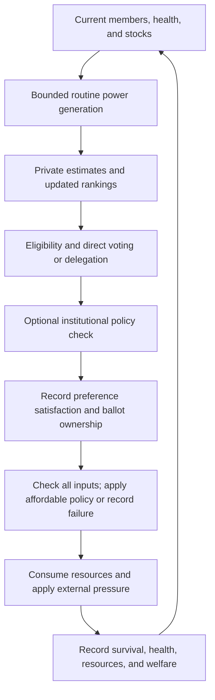

# A Plain-Language Walkthrough

The project is a controlled thought experiment made executable. A community has
limited supplies and must repeatedly choose one action. Changing the way members
make that choice can change who survives, whose preferences are followed, and
how many votes a small group of representatives controls.

You do not need programming knowledge to understand the question. For terms
used below, see the [glossary](glossary.md). For the equations, see the
[model](model.md) and [metric definitions](metrics.md).

## The Starting Community

The narrative frame is Vault 47, a Fallout-inspired isolated colony whose
governance is the experiment. Can residents sustain themselves with limited
resources, and what political costs accompany that survival? Imagined lunar
bases and space settlements provide a parallel motivation for this problem.
The reader compares histories from the Overseer's research terminal; this
context does not introduce additional game mechanics.

[Shelter Alpha](../data/scenarios/shelter_alpha.json) starts with 40 generated
members and shared resource stocks. Each member has a role, a health level,
personal policy priorities, and attitudes toward risk and cooperation. The
generator creates varied members rather than 40 identical voters.

Shelter Alpha remains the technical scenario name for compatibility. Its
rebalanced budget represents net food/water use after routine recycling and
combines hydroponic food production with water recovery. See
[resource balance](resource_balance.md) for the assumptions and comparisons.

A directed trust network describes possible delegation: Alice trusting Ben does
not imply that Ben trusts Alice. Trust edges have weights; a higher weight makes
an eligible specialist the preferred recipient when several are available.
These relationships are assumptions in the model, not survey data. Explicit
scenario edges supplement the generated network; they do not replace it.

There are four policies: farming, medicine, defense, and exploration. They are
bundles of assumed resource/health effects. The community chooses only one per
round, so it cannot address every need at once.

## One Round, Step by Step

At the start of each inhabited cycle, routine generation adds up to 2 energy
units, limited by a capacity of 50 in the baseline.

1. **Observe imperfectly.** Members estimate stocks and expected policy effects.
   Their estimates can be wrong. Under default settings, a farmer makes smaller
   assessment errors when evaluating farming than when evaluating medicine.
   This does not force the farmer to prefer farming.
2. **Rank policies.** Each member balances estimated reserve gains, healing,
   injury risk, and a small contribution from their original priorities. Rankings
   can change when water runs low or health deteriorates. The planning horizon
   defines a desired buffer, not a forecast of several simulated future rounds.
3. **Choose collectively.** Living, unsanctioned members participate. They may
   vote directly or delegate, depending on the selected mechanism. Delegation
   uses the member's current first choice as the topic and the representative's
   current first choice as the ballot receiving the transferred weight.
4. **Apply optional rules.** With `--use-prolog`, the selected policy can be
   replaced if institutional constraints prohibit it. The first allowed policy
   in declaration order is used; this is a simple fallback, not an optimal repair.
5. **Separate decision and outcome.** Satisfaction and ballot ownership are
   recorded before policy effects. An unaffordable action is recorded but has
   no policy effects. An affordable action pays its inputs, produces supplies,
   and can treat residents using available medicine. Limited medicine reduces
   all requested treatments proportionally. Consumption then occurs, and
   external pressure can cause deaths. Material outcomes are
   recorded afterward.

Scarcity penalties are calculated after consumption and before shock resource
losses; shocks add their direct health damage in the same round. A shock's stock
loss can increase scarcity pressure in the next round. This timing is part of
the current implementation, not an implicit continuous-time model.

## A Small Delegation Example

Alice and Ben initially favor farming. Both trust Chloe, an eligible farming
specialist. Chloe currently favors medicine because her assessment identifies
a stronger health need. Under expert delegation, Alice's and Ben's transferred
votes support Chloe's current choice. If Chloe votes directly, she controls all
three original ballots and medicine wins.

This example shows both sides of delegation: specialist judgment can redirect
collective action, while ballot control becomes concentrated. Accuracy and
trust do not guarantee that Chloe's assessment is correct. The power indicator
counts actual resolved ballots rather than simply counting Chloe's network links.

## Why Comparisons Share External Events

Suppose exploration requires more random calculations than farming. With a
single random sequence, that difference could accidentally change the next
storm. The simulator gives external storms, individual background damage,
policy effects, and private assessments separate identities instead.

For the same scenario, round, member, and seed, external draws match across
rules. A member's death does not change another member's later draws. Resource
levels and health can still differ because the policies and survivor counts
differ. Those are outcomes we want to compare.

## Why Several Metrics Are Needed

Four members at health 0.9 and four at health 0.1 both have zero health dispersion.
The second community is not doing equally well. Survival and health levels make
the distinction visible. Similarly, a high average among surviving members may
hide the deaths of unhealthy members; population health retains those deaths
in its denominator.

Satisfaction asks whether the chosen policy matches eligible members' rankings.
Concentration asks who controls their original ballots. Neither replaces the
material indicators. A community can make popular decisions that fail to preserve
its members, or survive under a highly concentrated decision process.

When no one survives, survivor health is undefined. When no one can vote,
satisfaction and concentration are undefined. Blank cells represent these
absences; they do not represent equality, zero error, or unanimous agreement.

## What the Current Results Establish

The code can compare these mechanisms under explicit assumptions and reproduce
the comparisons. It does not yet establish which mechanism works best in real
crises. The recorded review suite includes frequent extinction, so the balance
of production, consumption, and health dynamics needs further investigation.
See [project status](project_status.md) for the checked configuration and
[limitations](limitations.md) for the remaining boundaries.
